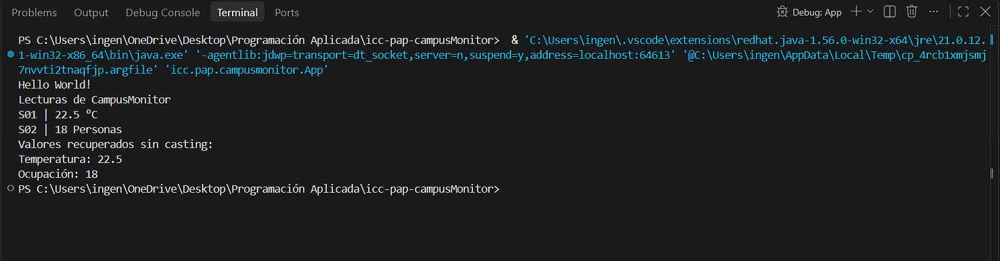

Qué representa la clase Lectura<T>.
La clase Lectura representa los como un bosquejo de los datos que vamos a usar en el main al momento de instaciarlos.
Qué representa T y por qué permite utilizar la misma clase para temperatura y ocupación.
T representa un tipo de dato genérico, el cual permite tener como un esqueleto o estructura de la clase, la cual luego se ocupará al momento de ocupar datos específicos al momento de instaciar en el app.
Qué agregaste en App.java.
Agregué un runLectura() para instanciar la clase con los datos que nos pide, de paso imprimirlos de la misma manera en la consola.

2. Ejecucción correcta

Se pueden guardar los resultados directamente en variables Double e Integer, sin casting gracias a al autoboxing pasando de primitivo a objeto.