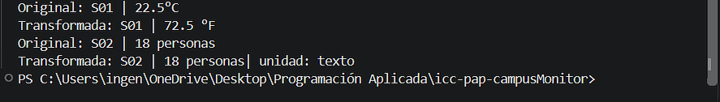

R representa el tipo de dato siendo este genérico, y transformar es el mismo tipo de dato aunque runTransformaciones no lo sea porque en el método se da la estructura de como se van a usar los datos independientemente de cuales sean estos.

En Lectura se agregó un método genérico para transformar con sus respectivas validaciones, y en App implementamos runTransformaciones junto con su llamada en el Main

